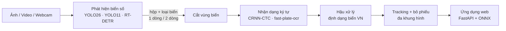

# Nhận diện biển số xe Việt Nam (ALPR)

Hệ thống phát hiện và nhận dạng biển số xe Việt Nam theo thời gian thực từ ảnh, video và webcam,
sử dụng thị giác máy tính và học sâu.

> Bài tập lớn học phần **Trí tuệ nhân tạo (INFO3005)**, Trường Đại học CMC, năm học 2025–2026.
> Giảng viên hướng dẫn: Vũ Việt Vũ. Thực hiện: Nhóm 3.


---

## Mục lục

- [Tổng quan](#tổng-quan)
- [Tiến độ](#tiến-độ)
- [Cấu trúc repo](#cấu-trúc-repo)
- [Dữ liệu](#dữ-liệu)
- [Kết quả phân tích dữ liệu](#kết-quả-phân-tích-dữ-liệu)
- [Cài đặt và chạy](#cài-đặt-và-chạy)
- [Biên dịch báo cáo](#biên-dịch-báo-cáo)
- [Thành viên](#thành-viên)
- [Tài liệu tham khảo](#tài-liệu-tham-khảo)

## Tổng quan

**Mục tiêu**

- Phát hiện và đọc biển số ô tô (1 dòng, 2 dòng) và mở rộng sang biển xe máy.
- Chạy theo thời gian thực trên webcam, xử lý ảnh và video tải lên.
- Ứng dụng web có lịch sử nhận dạng và liên kết tới trang tra cứu vi phạm chính thức.
  Hệ thống **không** tự động truy vấn trang tra cứu.

**Pipeline**



| Thành phần | Lựa chọn |
|---|---|
| Phát hiện biển số | So sánh YOLO26, YOLO11, RT-DETR (Ultralytics), 2 lớp: `plate_1row`, `plate_2row` |
| Nhận dạng ký tự | Baseline EasyOCR / PaddleOCR; chính: CRNN + CTC, fast-plate-ocr huấn luyện trên VNLP |
| Video | ByteTrack, bỏ phiếu theo từng vị trí ký tự, luật định dạng biển Việt Nam |
| Triển khai | ONNX Runtime, FastAPI; chạy trên máy cá nhân và chia sẻ qua Cloudflare Tunnel |
| Huấn luyện | Máy cá nhân (RTX 3050 4 GB) và Kaggle Notebooks (GPU miễn phí) |

## Tiến độ

- [x] Phân tích bài toán, chọn phương pháp
- [x] Phân tích và làm sạch nhãn tập VNLP, chia train/val/test theo biển số
- [x] Báo cáo LaTeX: phân tích dữ liệu, thiết kế giải pháp
- [ ] Kiểm tra ảnh (ảnh hỏng, ảnh trùng) và sinh dataset YOLO / OCR (notebook 02, 03)
- [ ] Thu thập tập kiểm thử thực tế từ nguồn công khai
- [ ] Huấn luyện và so sánh mô hình phát hiện
- [ ] Huấn luyện và so sánh mô hình nhận dạng ký tự
- [ ] Tracking, ghép pipeline, đo tốc độ thời gian thực
- [ ] Ứng dụng web và triển khai
- [ ] Đánh giá trên tập thực tế, hoàn thiện báo cáo

## Cấu trúc repo

```
.
├── alpr-project/                  # Mã nguồn (xem alpr-project/README.md)
│   ├── notebooks/                 # Jupyter Notebook, chạy theo số thứ tự
│   │   ├── 01_phan_tich_va_lam_sach_nhan.ipynb
│   │   ├── 02_kiem_tra_anh.ipynb
│   │   ├── 03_tao_dataset.ipynb
│   │   └── 04_du_lieu_ngoai.ipynb
│   ├── src/alpr/                  # Hàm dùng chung: định dạng biển số, đường dẫn dữ liệu
│   ├── data/labels/               # Nhãn đã làm sạch + chia tập (vnlp_manifest.csv)
│   ├── reports/                   # Báo cáo phân tích dữ liệu, hình
│   ├── config.example.json        # Đường dẫn tới dữ liệu
│   └── requirements.txt
├── bao_cao/                       # Báo cáo LaTeX (main.tex, chapters/, sections/, images/)
│   └── Nhóm 3 - Hệ thống nhận dạng biển số xe ô tô.pdf
└── .gitignore
```

Dữ liệu ảnh, dataset sinh ra, video và trọng số mô hình **không** nằm trong repo (xem [`.gitignore`](.gitignore)).

## Dữ liệu

Nhóm sử dụng tập **VNLP (Vietnamese License Plate)** gồm 37.297 ảnh có nhãn hộp biển số và chuỗi ký tự,
do Phạm Thế Anh và cộng sự công bố. Tải dữ liệu tại
[Google Drive của tác giả](https://drive.google.com/drive/folders/19OnlE0gFXEMPyngxRZ980d4z0fGQ-C7T?usp=sharing).
Khi sử dụng cần trích dẫn bài báo gốc (xem [Tài liệu tham khảo](#tài-liệu-tham-khảo)).

Đặt dữ liệu ở thư mục bất kỳ rồi khai báo đường dẫn trong `alpr-project/config.json`
(chép từ `config.example.json`):

```json
{
  "vnlp_root": "E:/vietnamese-license-plate-recognition/VNLP",
  "datasets_dir": "E:/vietnamese-license-plate-recognition/datasets",
  "external_dir": "E:/vietnamese-license-plate-recognition/external"
}
```

`vnlp_root` là thư mục chứa `detection/one_row`, `detection/two_rows`, `detection/two_rows_label_xe_may`.
Nên để `datasets_dir` cùng ổ đĩa với `vnlp_root` để notebook 03 dùng hard link, không tốn thêm dung lượng.

## Kết quả phân tích dữ liệu

Chi tiết: [`alpr-project/reports/DATA_REPORT.md`](alpr-project/reports/DATA_REPORT.md).

| Hạng mục | Kết quả |
|---|---|
| Số ảnh | 37.297 (ô tô 1 dòng 19.086 · ô tô 2 dòng 12.618 · xe máy 5.593) |
| Số biển khác nhau | 20.911 |
| Cùng xe ở 2 thư mục ô tô | 10.465 biển (ảnh đầu xe và đuôi xe) |
| Rò rỉ nếu chia ngẫu nhiên | khoảng 66% ảnh test có biển đã nằm trong train |
| Nhãn sai | 59 nhãn đáng ngờ: 37 đã sửa, 21 đúng (định dạng đặc biệt), 1 không đọc được |
| Lệch phân bố | mã tỉnh 36 chiếm 74,2% |
| Tọa độ nhãn | `(x1, y1, x2, y2)`, không phải `(x, y, w, h)` như tài liệu gốc ghi |

Sau làm sạch, dữ liệu được chia **theo chuỗi biển số** (không biển nào nằm ở hai tập):

| Tập | Số ảnh | Ô tô 1 dòng | Ô tô 2 dòng | Xe máy |
|---|---:|---:|---:|---:|
| train | 29.841 | 15.258 | 10.108 | 4.475 |
| val | 3.729 | 1.929 | 1.241 | 559 |
| test | 3.727 | 1.899 | 1.269 | 559 |


## Cài đặt và chạy

Yêu cầu: Python 3.10+; GPU NVIDIA nếu huấn luyện trên máy (không bắt buộc cho phần xử lý dữ liệu).

```powershell
git clone https://github.com/suzynotsusie/vietnamese-license-plate-recognition.git
cd vietnamese-license-plate-recognition/alpr-project

python -m venv .venv
.venv\Scripts\activate          # Linux/macOS: source .venv/bin/activate
pip install -r requirements.txt

copy config.example.json config.json   # rồi sửa đường dẫn dữ liệu
jupyter notebook notebooks
```

Chạy các notebook theo thứ tự:

| Notebook | Việc làm | Cần ảnh gốc |
|---|---|:---:|
| `01_phan_tich_va_lam_sach_nhan` | Đọc nhãn, sửa nhãn sai, thống kê, chia tập theo biển số (đã chạy sẵn) | Không |
| `02_kiem_tra_anh` | Tìm ảnh thiếu/hỏng, hộp sai, ảnh trùng hoặc gần trùng | Có |
| `03_tao_dataset` | Sinh dataset YOLO (`vnlp_det`) và ảnh biển cắt cho OCR (`vnlp_ocr`) | Có |
| `04_du_lieu_ngoai` | Trích khung hình từ video, nhập bộ dữ liệu Roboflow, lọc ảnh trùng VNLP | Có |

## Biên dịch báo cáo

Báo cáo viết bằng LaTeX, biên dịch bằng **XeLaTeX** (ví dụ MiKTeX hoặc TeX Live), chạy 2 lần để cập nhật mục lục:

```bash
cd bao_cao
xelatex main.tex
xelatex main.tex
```

Thông tin nhóm, đề tài và phân công nằm trong `bao_cao/metadata.tex`.

## Thành viên

| Thành viên | Mã SV | Phụ trách |
|---|---|---|
| Nguyễn Thanh Tùng | BIT253534 | Nhóm trưởng; tracking video, tích hợp hệ thống |
| Vũ Viết Trí | BAI250063 | Dữ liệu và đánh giá |
| Nguyễn Hải Dương | BAI250020 | Phát hiện vị trí biển số |
| Trần Thị Kim Uyên | BAI250072 | Ứng dụng web, triển khai, tổng hợp báo cáo |
| Chu Minh Tuệ | BIT250378 | Nhận dạng ký tự trên biển số |

## Tài liệu tham khảo

1. T.-A.-L. Trinh, T. A. Pham, V.-D. Hoang. *Layout-invariant license plate detection and recognition.*
   MAPR 2022, pp. 1–6.
2. T. A. Pham. *Effective deep neural networks for license plate detection and recognition.*
   The Visual Computer, 39(3), 927–941, 2023.
3. [Ultralytics YOLO](https://docs.ultralytics.com)
4. Y. Zhang et al. *ByteTrack: Multi-object tracking by associating every detection box.* ECCV 2022.
5. B. Shi, X. Bai, C. Yao. *An end-to-end trainable neural network for image-based sequence recognition
   and its application to scene text recognition.* IEEE TPAMI, 2017.
6. [fast-plate-ocr](https://github.com/ankandrew/fast-plate-ocr)

```bibtex
@article{PhamTA23,
  title   = {Effective deep neural networks for license plate detection and recognition},
  author  = {Pham, The-Anh},
  journal = {The Visual Computer},
  volume  = {39},
  number  = {3},
  pages   = {927--941},
  year    = {2023}
}
```

---

Dữ liệu VNLP thuộc về nhóm tác giả gốc và không được phân phối lại trong repo này.
