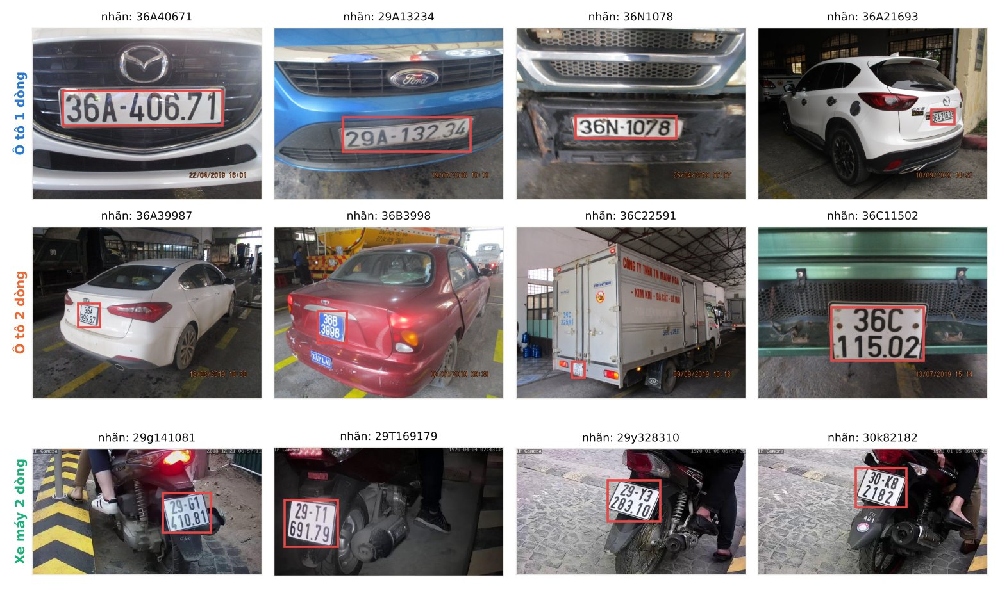
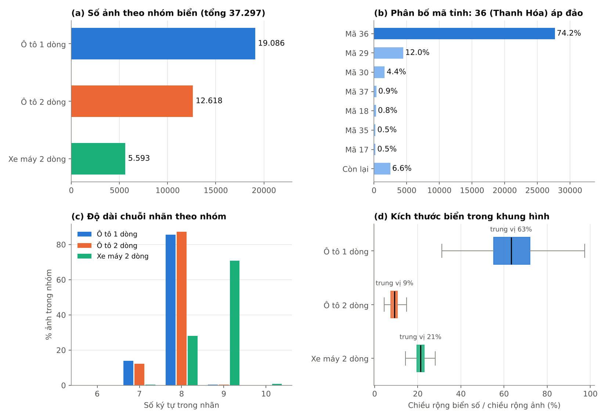
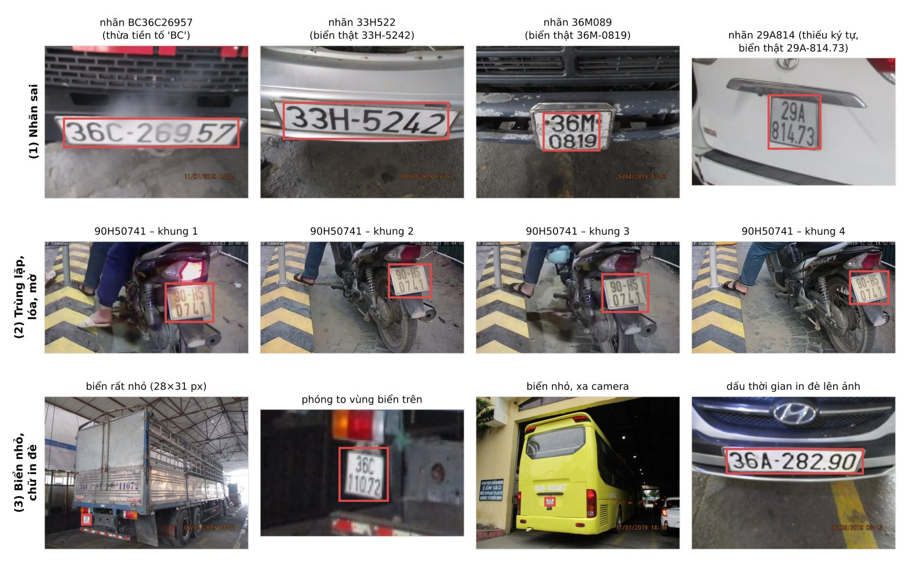

# Báo cáo phân tích và làm sạch dữ liệu VNLP

Ngày lập: 22/10/2026. Số liệu tính trên toàn bộ 37.297 nhãn, trừ các mục ghi rõ là mẫu.

## 1. Tổng quan

| Thư mục | Số ảnh | Loại biển | Phương tiện | Ghi chú |
|---|---|---|---|---|
| `one_row` | 19.086 | 1 dòng | ô tô | chủ yếu chụp cận **đầu xe** |
| `two_rows` | 12.618 | 2 dòng | ô tô | chủ yếu chụp **đuôi xe**, toàn thân xe |
| `two_rows_label_xe_may` | 5.593 | 2 dòng | xe máy | camera IP phía sau xe máy |

- Kích thước ảnh: rộng 640 px, cao 480 / 360 / 352 px (theo mẫu 148 ảnh).
- Nhãn nằm trong tên tệp. Tọa độ là **(x1, y1, x2, y2)**, không phải (x, y, w, h) như readme gốc ghi
  (đã kiểm tra bằng cách vẽ lại hộp lên ảnh).

## 2. Các vấn đề phát hiện được

### 2.1 Cùng một xe xuất hiện ở nhiều ảnh: vấn đề nghiêm trọng nhất

- Chỉ có **20.911 biển số khác nhau** cho 37.297 ảnh.
- **10.465 biển xuất hiện ở cả `one_row` và `two_rows`**: cùng một ô tô được chụp cả đầu xe (biển dài)
  lẫn đuôi xe (biển vuông).
- 29.304 ảnh (78,6%) có biển số trùng với ít nhất một ảnh khác. Ở nhóm xe máy có biển xuất hiện tới
  9 lần (các khung hình liên tiếp).
- **Nếu chia ngẫu nhiên từng ảnh (80/10/10), khoảng 66% ảnh trong tập test có cùng biển số nằm trong tập train**.
  Khi đó mô hình OCR chỉ cần "nhớ" biển và độ chính xác đo được sẽ bị thổi phồng.

**Đã xử lý:** chia theo chuỗi biển (group split). Kết quả: 0 biển bị chia sang hai tập.

### 2.2 Nhãn sai

Lọc bằng biểu thức chính quy định dạng biển VN được 59 nhãn đáng ngờ. Mình xem từng ảnh
(`figures/label_review_*.jpg`) và chia ra:

| Kết quả | Số nhãn | Ví dụ |
|---|---|---|
| Sai, đã sửa theo ảnh | 37 | `BC36C26957` thành `36C26957`; `36A041270` thành `36A04270` (thừa 1 số); `29A814` thành `29A81473` (thiếu); `33H522` thành `33H5242`; `36M089` thành `36M0819` |
| Đúng, nhưng là định dạng đặc biệt | 21 | xe máy kiểu cũ `31 960-H4`, `29 947-RY`; biển nước ngoài `29-636-NN-479`; biển xanh `80B-6789` |
| Không đọc được | 1 | `29I113873` (giữ cho detection, loại khỏi OCR) |

Kiểu lỗi phổ biến nhất là **thừa một chữ số** (9 ký tự thay vì 8) hoặc thừa tiền tố `B`, `BC`, `BD`.
Nhiều lỗi nằm ở các tệp đánh số liên tiếp (`1_1949`–`1_1961`, `1_1259`–`1_1261`, `2_1068`–`2_1070`), nhiều khả năng do cùng một đợt gán nhãn.

Kiểm tra thêm 89 ảnh mẫu có nhãn đúng định dạng: không thấy nhãn sai. Tỷ lệ lỗi còn lại nhiều khả năng
rất thấp, nhưng chưa thể khẳng định là bằng 0.

Chi tiết từng nhãn: `data/labels/label_fixes.csv`.

### 2.3 Nhãn không đồng nhất

- 3.715 nhãn viết thường (`29g141081`), chủ yếu ở nhóm xe máy. **Đã chuẩn hóa** về in hoa.
- Có 34 biển xe máy điện `MĐ` (ghi là `MD`). Bộ ký tự OCR cần có chữ `D` ở vị trí seri.

### 2.4 Lệch phân bố

- Mã tỉnh 36 (Thanh Hóa) chiếm 74,2%. Có 70 mã tỉnh nhưng 32 mã có dưới 20 ảnh.
- Biển ô tô chủ yếu dài 8 ký tự; biển xe máy chủ yếu dài 9 ký tự.
- Sau khi chia: tập test có 3.727 ảnh, trong đó 947 ảnh không thuộc mã 36. Đủ để báo cáo riêng hai nhóm.

### 2.5 Lệch miền (domain gap)

Toàn bộ ảnh chụp trong nhà đăng kiểm hoặc bãi xe. Không có cảnh đường phố, xe chạy nhanh, ban đêm
ngoài trời hay mưa. Điểm cao trên tập test VNLP **không** chứng minh được hệ thống chạy tốt ngoài đường.
Đây là lý do cần một tập kiểm thử từ nguồn khác (mục 4).

### 2.6 Khác

- Dấu thời gian in đè ở góc ảnh ô tô: mô hình có thể học nhầm, nhưng không nằm trong hộp biển nên ít ảnh hưởng tới OCR.
- Biển 2 dòng ô tô rất nhỏ (trung vị khoảng 9% chiều rộng ảnh): khi huấn luyện detector nên giữ `imgsz=640`.

## 3. Kết quả làm sạch

`data/labels/vnlp_manifest.csv` có 37.297 dòng với các cột:
`rel_path, subset, plate_type, vehicle, raw_label, label, label_status, plate_format, province, x1, y1, x2, y2, group, split, use_for_ocr`.

| Tập | Ảnh | ô tô 1 dòng | ô tô 2 dòng | xe máy | Tỷ lệ mã 36 |
|---|---|---|---|---|---|
| train | 29.841 | 15.258 | 10.108 | 4.475 | 74,1% |
| val | 3.729 | 1.929 | 1.241 | 559 | 74,3% |
| test | 3.727 | 1.899 | 1.269 | 559 | 74,6% |

Chưa kiểm tra (cần chạy notebook `02_kiem_tra_anh.ipynb` trên máy vì cần đọc ảnh gốc):
ảnh thiếu hoặc hỏng, ảnh trùng hoàn toàn hoặc gần trùng nhưng nhãn khác nhau.

## 4. Hướng giải quyết khi không tự chụp được ảnh

Thứ tự ưu tiên, từ dễ đến khó:

### 4.1 Tập kiểm thử thực tế từ video có sẵn trên mạng (ưu tiên số 1)

1. Tìm video giao thông Việt Nam (camera hành trình, camera đường phố, quay cổng ra vào) trên YouTube.
   Bật bộ lọc **Creative Commons**, hoặc dùng video được tác giả cho phép. Ưu tiên ban đêm, mưa, đường đông.
2. Trích khung hình: notebook `04_du_lieu_ngoai.ipynb` (phần 1) (1 khung hình/giây, tự bỏ khung gần giống nhau).
3. Gán nhãn 300–500 khung hình trên Roboflow (gói miễn phí) hoặc CVAT. Khi đã có detector huấn luyện
   trên VNLP, dùng nó gán nhãn trước rồi người sửa lại, nhanh hơn nhiều so với vẽ tay.
4. Chia theo video: các khung hình của cùng một video chỉ nằm trong một tập.
5. Chỉ dùng nội bộ cho đồ án, không phát tán lại video hoặc ảnh.

Bộ này phục vụ hai việc: chọn detector (YOLO26 / YOLO11 / RT-DETR) và đo khoảng cách miền
(VNLP so với thực tế), đúng như báo cáo đã cam kết.

### 4.2 Bộ dữ liệu công khai khác

| Nguồn | Nội dung | Lưu ý |
|---|---|---|
| [GreenParking: DataThiGiacMayTinh](https://github.com/thigiacmaytinh/DataThiGiacMayTinh) | biển xe máy chụp ở bãi xe; repo còn có `char_bien_so.zip` (ký tự biển) | không ghi giấy phép; theo [bài Viblo](https://viblo.asia/p/nhan-dien-ki-tu-tren-bien-so-xe-viet-nam-2oKLnxWZ4QO) là ảnh thô chưa gán nhãn hộp |
| [Roboflow Universe](https://universe.roboflow.com) (tìm "license plate vietnam", "bien so xe") | nhiều bộ nhỏ, đã có hộp YOLO, thường giấy phép CC BY 4.0 (ví dụ [nhandienbiensoVN](https://universe.roboflow.com/phms-workspace-p7wre/nhandienbiensovn-lffc0): 116 ảnh) | chất lượng không đều; **nhiều bộ là bản tải lại VNLP hoặc GreenParking** nên phải chạy notebook 04 (phần 3) |
| [UIT MAPR 2018: Vietnamese bike LP](https://mapr.uit.edu.vn/2018/vietnamese-bike-license-plate-recognition) | 3.000 ảnh xe máy ở bãi xe khách sạn, có hộp và chuỗi | trang ghi link tải "update soon"; có thể email ban tổ chức xin |

Cách dùng: nhập bằng notebook 04 (phần 2), lọc trùng bằng notebook 04 (phần 3), mặc định chỉ làm **test**.
Bộ nào đủ lớn và sạch thì có thể chia một phần vào train để tăng đa dạng cho detector.

### 4.3 Dữ liệu tổng hợp cho OCR (giảm lệch mã tỉnh)

- Sinh ảnh biển giả: vẽ chuỗi biển ngẫu nhiên (mã tỉnh 11–99, seri, số) bằng font biển số lên nền trắng
  đúng tỉ lệ biển 1 dòng / 2 dòng, rồi làm xấu ảnh (mờ, nhiễu, nghiêng, lóa, nén JPEG).
- Trộn khoảng 20–30% ảnh tổng hợp vào train OCR. Test chỉ dùng ảnh thật.
- Tham khảo nâng cao: sinh ảnh biển bằng mô hình khuếch tán (diffusion), xem [arXiv 2501.03374](https://arxiv.org/abs/2501.03374).

### 4.4 Tăng cường dữ liệu mô phỏng điều kiện đường phố

Thực hiện trực tuyến khi huấn luyện, không tạo sẵn ảnh:
- Detector: mờ chuyển động, giảm sáng hoặc giả ban đêm, nhiễu, nén JPEG, thu nhỏ ảnh để biển xa hơn.
  **Không lật ngang** vì sẽ làm ngược ký tự.
- OCR: xoay ±5°, phối cảnh nhẹ, mờ, lóa, độ tương phản thấp.

### 4.5 Tự gán nhãn (pseudo-label), nếu còn thời gian

Chạy hệ thống trên nhiều video chưa gán nhãn. Giữ những biển mà tracking và bỏ phiếu đa khung hình cho
kết quả ổn định và đúng định dạng làm nhãn giả, rồi tinh chỉnh lại mô hình.

## 5. Việc tiếp theo

1. Chạy notebook 02 và 03 trên máy, xem `reports/image_check_summary.json`.
2. Huấn luyện baseline: YOLO11n trên `vnlp_det` và OCR trên `vnlp_ocr` (trong `datasets_dir`, mặc định `E:/vietnamese-license-plate-recognition/datasets`).
3. Song song: thu 300–500 khung hình từ video (mục 4.1) làm tập kiểm thử thực tế.
4. Báo cáo kết quả riêng cho: VNLP test, VNLP test không phải mã 36, tập thực tế.
